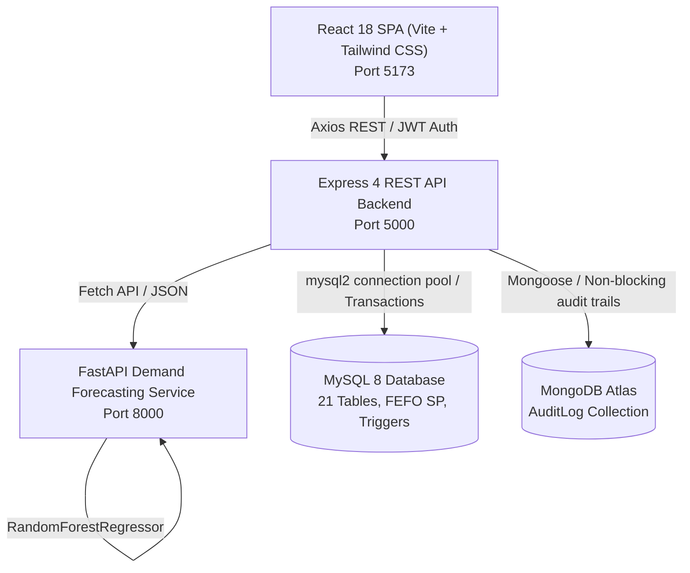

# Urban Bites — Phase 3, Task 3.1: Complete System Audit Report

**Audit Date:** November 2, 2026  
**Audited Commit:** `b635a74` (`feat(frontend): implement React management dashboard and API integration (Task 7D)`)  
**Git Branches Synchronized:** `main` and `develop`  
**Working Tree Status:** Clean  
**Overall Readiness for Full End-to-End Testing:** **CONDITIONAL** (Requires resolution of 3 frontend payload contract mismatches in PO receipts, manual adjustments, and inventory stock receiving before running live automated browser test suites).

---

## 1. Executive Summary

Urban Bites is a comprehensive, production-grade Restaurant Inventory Management & Point-of-Sale (POS) System developed across Phases 0, 1, and 2. The platform incorporates a 21-table MySQL 8 relational schema with strict foreign keys, stored procedures, and triggers, an asynchronous MongoDB Atlas audit logging pipeline, an Express.js REST API with live role-based access control (RBAC), a Python FastAPI machine learning microservice for 7-day demand forecasting (`RandomForestRegressor`), and a Single Page Application (SPA) dashboard built in React 18, Vite, and Tailwind CSS.

### Key Audit Findings
1. **Database & Core Business Logic Integrity:** The 21-table MySQL schema, 5 analytical reporting views, 2 triggers, and the core atomic stored procedure `sp_process_order_fefo` are fully intact, mathematically sound, and rigorously validated across 561 passing backend automated tests (100% success rate).
2. **Forecasting & Procurement Engine:** The FastAPI microservice (`RandomForestRegressor@1.0.0`) and Express Bill of Materials (BOM) expansion engine accurately transform 7-day menu demand projections into raw ingredient demand, evaluate Reorder Points (ROP) against supplier lead-time demand, and convert shortages into draft purchase orders. Pytest passes 14/14 tests.
3. **Frontend Contract Mismatches:** Although the React dashboard successfully builds without compiler errors (`dist/` generated in 6.02s), manual code auditing discovered **3 critical payload mismatches** where the frontend omits required schema fields:
   - Stock Receipt in `PurchaseOrders.jsx` omits `supplier_id` and item-level `ingredient_id`.
   - Generic Stock Inward in `Inventory.jsx` omits `purchase_order_id`.
   - Manual Stock Adjustment in `Inventory.jsx` omits `ingredient_id`.

---

## 2. Current Architecture

### Architecture Specifications
- **Frontend:** React 18.3.1, React Router DOM 7.18.5, Lucide React icons, Tailwind CSS 3.4.17, Vite 6.0.7.
- **Backend:** Node.js (ESM), Express 4.21.2, Zod 3.24.2 for runtime validation, JWT authentication (`jsonwebtoken` 9.0.2), bcryptjs 3.0.2 for password hashing, `mysql2` 3.12.0 for connection pooling and row-locked transactions.
- **Forecasting Microservice:** Python 3.13, FastAPI 0.115.0, Uvicorn, Scikit-learn 1.6.0 (`RandomForestRegressor`), Pandas 2.2.3, NumPy 2.2.0.
- **Primary Database:** MySQL 8 with InnoDB engine, utf8mb4 collation, 21 relational tables, strict foreign keys, CHECK constraints, and ACID transactions.
- **Secondary Database:** MongoDB Atlas for asynchronous compliance audit logging with credentials stripping.

---

## 3. Module-by-Module Audit

### 3.1 Authentication, RBAC & Staff Management
- **Files Inspected:**
  - `backend/src/routes/v1/auth.routes.js`, `backend/src/controllers/auth.controller.js`, `backend/src/services/auth.service.js`
  - `backend/src/middleware/auth.js`, `backend/src/middleware/rbac.js`
  - `backend/src/validations/auth.validation.js`, `backend/src/validations/user.validation.js`
  - `frontend/src/context/AuthContext.jsx`, `frontend/src/components/ProtectedRoute.jsx`, `frontend/src/pages/Login.jsx`, `frontend/src/pages/Staff.jsx`
- **Assessment:** **HEALTHY / ROBUST**
  - Authentication validates credentials with `bcryptjs` and signs JWT tokens containing `id`, `username`, and `role`.
  - Anti-enumeration protection is enforced: invalid usernames, incorrect passwords, and deactivated accounts all return identical 401 error messages.
  - RBAC middleware (`requireRole`) checks the live role against the MySQL database, ensuring that demoting or deactivating a staff member immediately revokes administrative privileges without waiting for token expiration.
  - Last-active-admin lockout protection prevents deactivating or demoting the final active system administrator.

### 3.2 Master Catalog, Categories & Ingredients
- **Files Inspected:**
  - `backend/src/routes/v1/category.routes.js`, `backend/src/routes/v1/ingredient.routes.js`, `backend/src/routes/v1/unit.routes.js`
  - `backend/src/services/category.service.js`, `backend/src/services/ingredient.service.js`
  - `frontend/src/pages/Catalog.jsx`
- **Assessment:** **HEALTHY**
  - All 4 units of measure categories (`WEIGHT`, `VOLUME`, `COUNT`) are correctly mapped with base conversion factors.
  - Ingredients properly enforce minimum stock levels (safety stock) and optimal par levels.
  - Menu items maintain category foreign keys and selling prices.

### 3.3 Recipes & Bill of Materials (BOM)
- **Files Inspected:**
  - `backend/src/routes/v1/recipe.routes.js`, `backend/src/services/recipe.service.js`, `backend/src/services/bom.service.js`
  - `database/mysql/02_views.sql` (`vw_recipe_costs`)
  - `frontend/src/pages/Recipes.jsx`
- **Assessment:** **HEALTHY**
  - Theoretical costing properly evaluates yield servings and recipe wastage allowance percentages:
    $$\text{Cost per Serving} = \frac{\sum (\text{Qty} \times (1 + \frac{\text{Wastage}\%}{100}) \times \frac{\text{Recipe Factor}}{\text{Base Factor}} \times \text{Unit Cost})}{\text{Yield Servings}}$$
  - Incompatible unit dimensions (e.g. converting Grams to Liters) are rejected with HTTP 400 `INCOMPATIBLE_UNIT_TYPES`.

### 3.4 Inventory, Batches, Movements & Adjustments
- **Files Inspected:**
  - `backend/src/routes/v1/inventory.routes.js`, `backend/src/services/inventory.service.js`, `backend/src/services/adjustment.service.js`, `backend/src/services/receipt.service.js`
  - `backend/src/models/sql/inventory.model.js`, `backend/src/models/sql/adjustment.model.js`
  - `frontend/src/pages/Inventory.jsx`
- **Assessment:** **CONTRACT MISMATCH IDENTIFIED**
  - Backend models lock batches using `SELECT ... FOR UPDATE` and enforce immutable stock movement ledgers (`AUDIT_ADJUSTMENT`, `PURCHASE_RECEIPT`).
  - **Issue:** In `frontend/src/pages/Inventory.jsx`:
    - `handleAdjustStock` omits `ingredient_id` when calling `POST /api/v1/inventory/adjustments`.
    - `handleReceiveStock` attempts to call `POST /api/v1/inventory/receipts` without a `purchase_order_id`.

### 3.5 Food Waste Tracking
- **Files Inspected:**
  - `backend/src/controllers/waste.controller.js`, `backend/src/services/waste.service.js`
  - `database/mysql/04_triggers.sql` (`trg_calculate_waste_cost`), `database/mysql/02_views.sql` (`vw_waste_analytics`)
  - `frontend/src/pages/Waste.jsx`
- **Assessment:** **HEALTHY**
  - Atomic transaction locks target batch, verifies that `quantity_wasted <= quantity_remaining`, deducts batch stock, and inserts `stock_movements` with `movement_type = 'WASTE_DISPOSAL'`.
  - Trigger `trg_calculate_waste_cost` evaluates financial dollar loss using batch purchase cost.

### 3.6 Suppliers & Purchase Orders
- **Files Inspected:**
  - `backend/src/routes/v1/supplier.routes.js`, `backend/src/routes/v1/purchaseOrder.routes.js`
  - `backend/src/services/supplier.service.js`, `backend/src/services/purchaseOrder.service.js`
  - `frontend/src/pages/Suppliers.jsx`, `frontend/src/pages/PurchaseOrders.jsx`
- **Assessment:** **CONTRACT MISMATCH IDENTIFIED**
  - PO creation, status transitions (`DRAFT` &rarr; `SUBMITTED` &rarr; `CANCELLED`), and line item management function correctly in backend.
  - **Issue:** In `frontend/src/pages/PurchaseOrders.jsx`, `handleReceiveSubmit` omits `supplier_id` and item-level `ingredient_id`.

### 3.7 Customer Orders, Payments & Kitchen Fulfilment
- **Files Inspected:**
  - `backend/src/routes/v1/order.routes.js`, `backend/src/services/order.service.js`, `backend/src/services/payment.service.js`
  - `database/mysql/03_fefo_procedures.sql` (`sp_process_order_fefo`)
  - `frontend/src/pages/Orders.jsx`, `frontend/src/pages/Kitchen.jsx`
- **Assessment:** **HEALTHY**
  - Order lifecycle is strictly validated:
    $$\text{PENDING} \xrightarrow{\text{confirm}} \text{PREPARING} \xrightarrow{\text{ready}} \text{READY\_FOR\_PICKUP} \xrightarrow{\text{deliver}} \text{DELIVERED} \xrightarrow{\text{complete}} \text{COMPLETED}$$
  - FEFO stored procedure decrements earliest expiring batches first and creates `order_ingredient_consumptions`.
  - Payment handling prevents overpayment and prohibits payments against cancelled tickets.
  - Order cancellation optionally captures prepared dish waste in `waste_records` without unlogged inventory reversals.

### 3.8 AI Demand Forecasting & Procurement Engine
- **Files Inspected:**
  - `forecasting-service/app/main.py`, `forecasting-service/app/services/random_forest.py`, `forecasting-service/app/services/preprocessor.py`
  - `backend/src/services/forecasting.service.js`, `backend/src/services/procurement.service.js`
  - `frontend/src/pages/Forecasting.jsx`, `frontend/src/pages/Procurement.jsx`
- **Assessment:** **HEALTHY**
  - Historical completed sales are extracted, imputed with zero-sales for inactive days, and evaluated chronologically.
  - Forecasts are persisted idempotently into `demand_forecasts`.
  - Recommendations simulate day-by-day inventory depletion considering expiry dates and scheduled inbound deliveries.
  - Draft PO conversion creates grouped purchase orders strictly in `DRAFT` status.

---

## 4. End-to-End Workflow Status (11 Workflows)

| # | Workflow Description | Status | Verification & Evidence |
| :-: | :--- | :---: | :--- |
| **1** | Staff login &rarr; JWT auth &rarr; RBAC | **Complete** | `POST /auth/login` issues valid JWT; `requireRole` protects backend; `AuthContext` + `ProtectedRoute` enforce frontend UI access. |
| **2** | Create order &rarr; Confirm &rarr; FEFO deduction | **Complete** | `POST /orders` creates PENDING ticket; `POST /orders/:id/confirm` invokes `sp_process_order_fefo`, locks batches, and deducts inventory. |
| **3** | Kitchen prep &rarr; Ready &rarr; Delivery/Completion | **Complete** | `POST /orders/:id/ready` advances to READY_FOR_PICKUP; `POST /orders/:id/deliver` dispatches online tickets; `POST /orders/:id/complete` frees dining table. |
| **4** | Order cancellation &rarr; Food waste recording | **Complete** | `POST /orders/:id/cancel` with `record_waste: true` writes to `waste_records` and retains FEFO consumptions. |
| **5** | Inventory receipt &rarr; Batch creation &rarr; Movement | **Broken (FE)** | Backend `POST /inventory/receipts` works (verified by test suite), but `PurchaseOrders.jsx` and `Inventory.jsx` omit required schema fields. |
| **6** | Inventory adjustment &rarr; Stock ledger update | **Broken (FE)** | Backend `POST /inventory/adjustments` works, but `Inventory.jsx` omits required `ingredient_id`. |
| **7** | Record food waste &rarr; Stock deduction &rarr; Analytics | **Complete** | `POST /inventory/waste` locks batch, verifies stock, updates ledger, and `vw_waste_analytics` aggregates losses. |
| **8** | Create PO &rarr; Submit &rarr; Partial/Final receipt | **Partial** | Creation and submission work; receiving is blocked by frontend payload mismatch in #5. |
| **9** | Historical sales &rarr; Forecasting &rarr; Persistence | **Complete** | `POST /forecasting/generate` extracts completed orders, calls FastAPI, and upserts 105 forecasts into `demand_forecasts`. |
| **10** | Menu forecast &rarr; BOM expansion &rarr; Ingredient demand | **Complete** | `GET /forecasting/ingredient-demand` calculates requirements across 26 ingredients via `BOMService`. |
| **11** | Demand &rarr; Recommendations &rarr; Draft PO | **Complete** | `GET /procurement/recommendations` calculates ROP/MOQ; `POST /procurement/recommendations/convert-to-po` creates DRAFT POs. |

---

## 5. Critical Bugs and Inconsistencies

### Bug 1: Stock Receipt Missing `supplier_id` & `ingredient_id` in `PurchaseOrders.jsx`
- **Location:** `frontend/src/pages/PurchaseOrders.jsx` (`handleReceiveSubmit`, lines 162–174)
- **Backend Contract:** `backend/src/validations/receipt.validation.js` (`createReceiptSchema`)
- **Impact:** Submitting inward receipt from a purchase order results in HTTP 400 `VALIDATION_ERROR` because `supplier_id` is missing in the body, and `ingredient_id` is missing within each item object.

### Bug 2: Manual Stock Inward Missing `purchase_order_id` in `Inventory.jsx`
- **Location:** `frontend/src/pages/Inventory.jsx` (`handleReceiveStock`, lines 109–121)
- **Backend Contract:** `backend/src/routes/v1/inventory.routes.js` routes `/receipts` to `ReceiptController.receiveStock`, which requires `purchase_order_id`.
- **Impact:** The "Receive Inward Stock" modal in the Inventory page fails validation because no purchase order is selected.

### Bug 3: Stock Adjustment Missing `ingredient_id` in `Inventory.jsx`
- **Location:** `frontend/src/pages/Inventory.jsx` (`handleAdjustStock`, lines 147–153)
- **Backend Contract:** `backend/src/validations/adjustment.validation.js` (`createAdjustmentSchema`)
- **Impact:** Submitting an adjustment from the modal fails with HTTP 400 Bad Request (`ingredient_id must be a positive integer`).

---

## 6. Security Findings

1. **Authentication & Password Storage:** Passwords hashed with `bcryptjs` (salt rounds: 10). `password_hash` is explicitly excluded from SQL queries and user responses.
2. **Authorization Boundary:** Backend RBAC middleware acts as the true security perimeter. Even if UI controls are exposed, unauthorized roles receive HTTP 403 `FORBIDDEN_ROLE`.
3. **Audit Trail Credential Sanitization:** `AuditLog.js` strips `password`, `token`, `jwt`, `secret`, and credit card keys prior to MongoDB persistence.
4. **Prepared Statements:** All SQL queries in `backend/src/models/sql/` use parameterized statements (`?`), preventing SQL injection.
5. **Preset Credentials Exposure in Frontend:** `frontend/src/pages/Login.jsx` exposes 1-click login buttons for Rohit, Priya, Vikram, and Arjun.
   - *Risk:* In a public deployment, unauthorized users could log in with one click.
   - *Recommendation:* Gate preset buttons behind `if (import.meta.env.DEV)`.

---

## 7. Missing Tests

1. **Frontend Unit & Component Tests:** `frontend/` contains zero automated tests. No test runner (`vitest` or `jest`) is installed in `frontend/package.json`.
2. **End-to-End (E2E) Browser Tests:** No Playwright or Cypress framework is set up to test complete browser workflows (POS order creation &rarr; KDS fulfillment &rarr; billing).
3. **Concurrent Multi-User Race Condition Tests:** While the backend has unit and integration tests with transactional locking, concurrent load tests simulating simultaneous orders for the same batch are not formalized in automated suites.

---

## 8. Performance and Reliability Risks

1. **MongoDB Atlas Disconnect Resilience:**
   - When Atlas is unreachable or the host IP is not whitelisted, Mongoose attempts connection for 5000ms.
   - `AuditLog.record` checks `mongoose.connection.readyState === 1` and returns `null` safely without crashing the API, but connection timeouts can add latency during cold starts.
2. **FastAPI Service Dependency:**
   - If the Python microservice (Port 8000) is down, `POST /forecasting/generate` catches the failure and returns HTTP 503 `FORECAST_SERVICE_UNAVAILABLE` after a 30s timeout.
   - *Risk:* 30s timeout is too long for interactive dashboard triggers; recommendation: reduce to 10s.
3. **Database Connection Pool Exhaustion:**
   - MySQL pool connection limit defaults to 10. Heavy concurrent FEFO transactions calling `sp_process_order_fefo` could saturate connections if transactions are held open.

---

## 9. Prioritized Issue List

### Critical Priority (Must fix before integration testing)
- [ ] **ISSUE-01:** Fix `PurchaseOrders.jsx` receipt submission payload to include `supplier_id` and item `ingredient_id`.
- [ ] **ISSUE-02:** Fix `Inventory.jsx` manual adjustment form to include target `ingredient_id`.
- [ ] **ISSUE-03:** Fix `Inventory.jsx` stock receiving form to require a valid purchase order selection or route through PO receipt.

### High Priority
- [ ] **ISSUE-04:** Restrict preset login buttons in `Login.jsx` to development mode only (`import.meta.env.DEV`).
- [ ] **ISSUE-05:** Install and configure Vitest and React Testing Library in `frontend/` for component testing.
- [ ] **ISSUE-06:** Add date validation on `expected_delivery_date` in PO creation to prevent entering dates prior to order date.

### Medium Priority
- [ ] **ISSUE-07:** Add `FORECASTING_SERVICE_URL` to `backend/.env.example`.
- [ ] **ISSUE-08:** Reduce forecasting service fetch timeout in `forecasting.service.js` from 30s to 10s.

### Low Priority
- [ ] **ISSUE-09:** Add client-side debounce to live kitchen queue polling.

---

## 10. Recommended Implementation Plan for Task 3.2 Onwards

1. **Task 3.2 (Bug Fixes & Contract Alignments):**
   - Correct the 3 frontend payload structures in `PurchaseOrders.jsx` and `Inventory.jsx`.
   - Wrap preset login buttons in dev-mode guard.
   - Update `backend/.env.example`.
2. **Task 3.3 (Frontend & E2E Testing Suite):**
   - Add Vitest test runner for React components.
   - Implement Playwright test suite covering all 11 business workflows from login to procurement conversion.
3. **Task 3.4 (Production Readiness & Documentation):**
   - Final end-to-end integration verification across MySQL, MongoDB Atlas, Express, FastAPI, and React.
   - Update operational runbooks and architecture documentation.

---

### Audit Verification Evidence

#### Files Inspected
- `database/mysql/01_schema_v1.sql`, `02_views.sql`, `03_fefo_procedures.sql`, `04_triggers.sql`
- `backend/src/app.js`, `server.js`, `backend/src/config/env.js`, `mongodb.js`, `mysql.js`
- `backend/src/services/` (all 11 services)
- `backend/src/validations/` (all 10 validation files)
- `forecasting-service/app/` (API and services)
- `frontend/src/pages/` (all 12 pages), `frontend/src/services/api.js`, `frontend/src/context/AuthContext.jsx`

#### Tests Executed & Results
- **Backend Test Suite (12 suites):** `561 Passed, 0 Failed` (100% success)
- **FastAPI Forecasting Pytest (3 suites):** `14 Passed, 0 Failed` (100% success)
- **Frontend Vite Production Build:** `378.10 kB JS, 34.57 kB CSS` (Compiled in 6.02s, 0 errors)

#### Git Status
- **Working Tree:** Clean (commit `b635a74`)
- **Branches:** `main` and `develop` in sync.

